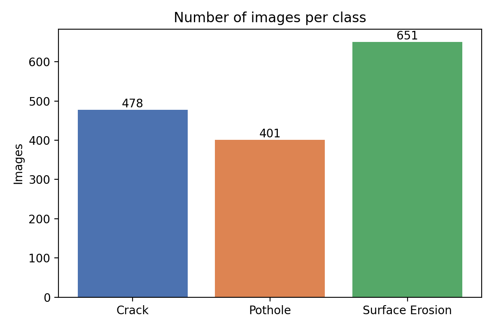
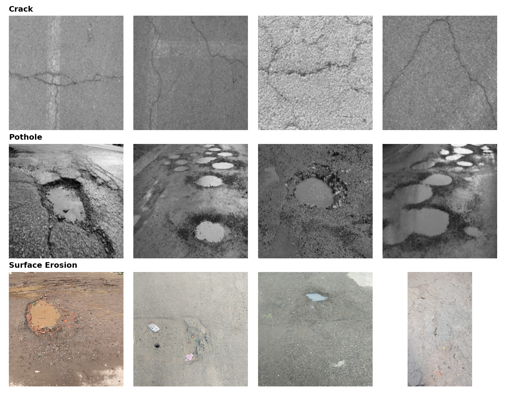
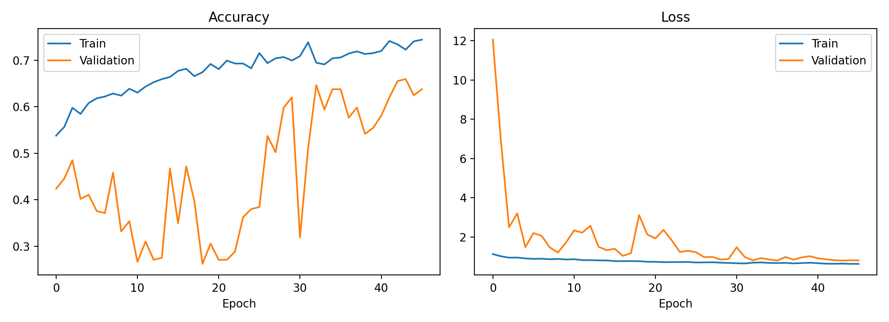
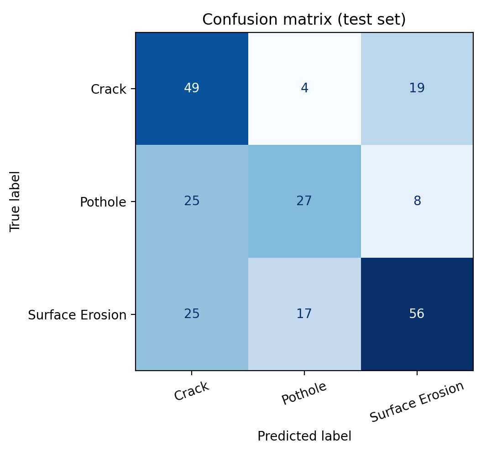
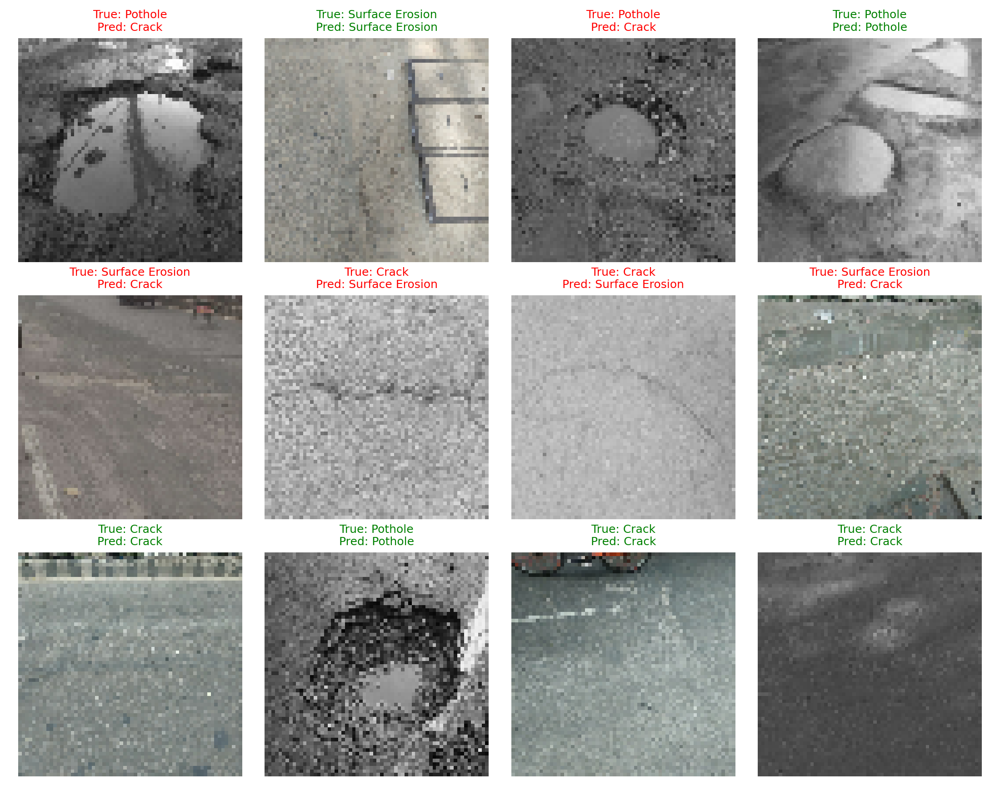

# Multi-Class Road Surface Damage Classification from Images Using ANN

An Artificial Neural Network (ANN) that classifies road-surface images into three damage classes: **Crack**, **Pothole** and **Surface Erosion**. The project was built in Python with TensorFlow/Keras and run in Jupyter Notebook.

## Dataset
- **Source:** Multiclass Road Surface Damage Classification Dataset, Mendeley Data - https://data.mendeley.com/datasets/697w4jkr2x
- **Size:** 1,530 RGB images in 3 classes (Crack: 478, Pothole: 401, Surface Erosion: 651)
- The dataset is not included in this repository because of its size. Download it from the link above and place the ZIP next to the notebook.

## Method
1. **Preprocessing:** images resized to 64 x 64, pixel values rescaled to 0-1, stratified split into train (70%, 1,071 images), validation (15%, 229) and test (15%, 230).
2. **Model:** fully connected ANN on flattened pixels: Dense(512) -> Dense(256) -> Dense(128) -> Dense(3, softmax), with batch normalisation, dropout (0.4 and 0.3), and light data augmentation (horizontal flip, small rotation). Total parameters: 6,459,651.
3. **Training:** Adam optimiser (learning rate 1e-3), class weights to balance the classes, early stopping and learning-rate reduction on plateau. Training stopped early at epoch 46 of a maximum of 60.
4. **Evaluation:** accuracy, precision, recall, F1-score and confusion matrix on the unseen test set.

## Results (test set, 230 images)
| Class | Precision | Recall | F1-score | Support |
|---|---|---|---|---|
| Crack | 0.49 | 0.68 | 0.57 | 72 |
| Pothole | 0.56 | 0.45 | 0.50 | 60 |
| Surface Erosion | 0.67 | 0.57 | 0.62 | 98 |
| **Overall accuracy** | | | **0.57** | 230 |

Test accuracy: **57.39%**, test loss: 0.9104.

### Figures
| | |
|---|---|
|  |  |
|  |  |

## Limitations
- A plain ANN on flattened 64 x 64 pixels ignores the spatial structure of images, which limits accuracy. A convolutional network would be a natural next step.
- Crack and Pothole images are mostly greyscale while Surface Erosion images are in colour, so the model may partly rely on colour.
- Some classes overlap visually (for example, severe cracking versus potholes), which shows up in the confusion matrix.
- The dataset is small (1,530 images), so results vary between runs.

## How to run
1. Install the requirements: `pip install -r requirements.txt`
2. Download the dataset ZIP from the Mendeley link and place it in the same folder as the notebook.
3. Open `road_damage_ann_jupyter.ipynb`, set `ZIP_PATH` to the ZIP's file name, and run the cells from top to bottom.

## Repository contents
- `road_damage_ann_jupyter.ipynb` - full notebook (data loading, model, training, evaluation)
- `results/` - saved figures, metrics and model summary
- `requirements.txt` - Python dependencies
